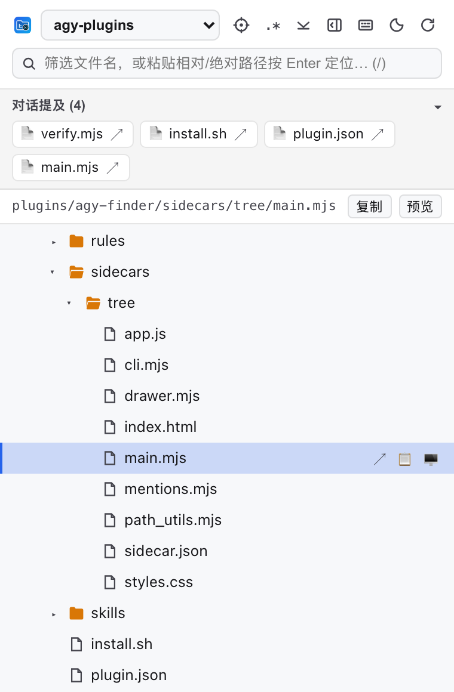
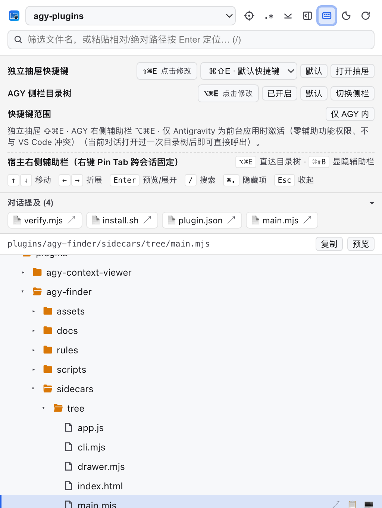
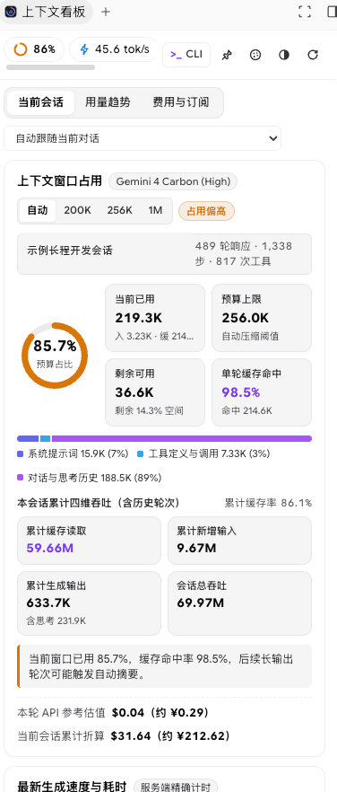
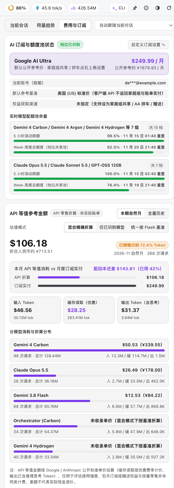
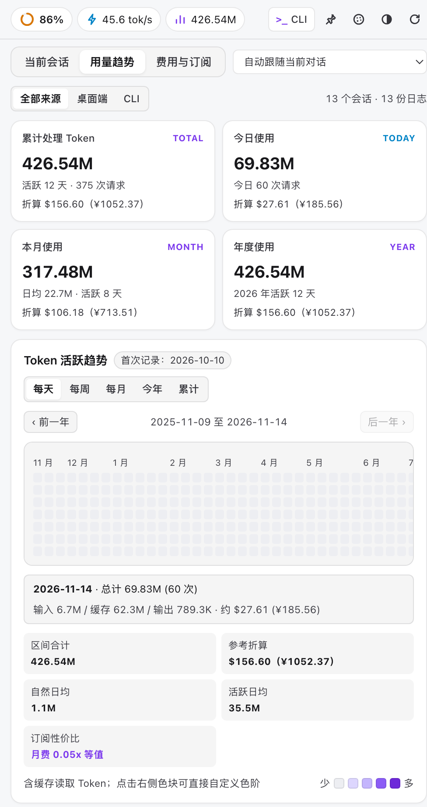

# AGY Plugins

面向 **Google Antigravity**（桌面端与 `agy` CLI）的开源 Sidecar 插件合集 -- **零外部依赖**、**不修改客户端核心文件**、**一键热更新**，让项目文件定位与上下文配额监控开箱即用。

**简体中文** | [English](README_EN.md)

| 插件 | 核心能力 | 当前版本 | 文档 |
| :--- | :--- | :---: | :--- |
| **`agy-finder`** | 右侧目录树、聊天路径 `[📂]` 定位 / HTML `[🌐]` 默认浏览器打开、对话提及提取、原生弹窗与 `⌘⇧E` 抽屉 | `v0.2.9` | [中文说明](plugins/agy-finder/README.md) · [EN](plugins/agy-finder/README_EN.md) |
| **`context-viewer`** | 上下文占比 / 10 类光谱 / 会话与分模型缓存率 / Swarm 整树 / 自定义日期趋势、双池配额、异常取证、菜单栏与置顶小窗（Desktop App 专用） | `v1.9.0` | [中文说明](plugins/agy-context-viewer/README.md) · [EN](plugins/agy-context-viewer/README_EN.md) |
| **`agy-cli-hud`** | `agy` CLI 与 Solo 专用零依赖轻量监控：输入栏下方 2/3 行分层状态栏、增量 JSONL 今日/本月与平均缓存、双池 5h/周额度、合规版 Google Colab 算力监控 | `v0.1.0` | [中文说明](plugins/agy-cli-hud/README.md) · [EN](plugins/agy-cli-hud/README_EN.md) |

---

## Agent 一句话安装

将下面任意一句直接发送给 Antigravity，即可自动完成安装、状态检查与快捷键配置提示：

> **全部安装：**
> ```text
> 请帮我安装 https://github.com/Dong-Kevin/agy-plugins 中的全部插件（macOS / Linux 运行 `bash -c "$(curl -fsSL https://raw.githubusercontent.com/Dong-Kevin/agy-plugins/main/install.sh)"`，Windows PowerShell 运行 `irm https://raw.githubusercontent.com/Dong-Kevin/agy-plugins/main/install.ps1 | iex`），完成后检查插件可用状态并总结各自快捷键。
> ```
> **只装单个插件**（将 `agy-finder` 替换为 `context-viewer` 或 `agy-cli-hud` 即可单独安装对应插件）：
> ```text
> 请帮我从 https://github.com/Dong-Kevin/agy-plugins 仅安装 agy-finder（macOS / Linux 运行 `curl -fsSL https://raw.githubusercontent.com/Dong-Kevin/agy-plugins/main/install.sh | bash -s -- agy-finder`，Windows PowerShell 运行 `$env:AGY_PLUGIN="agy-finder"; irm https://raw.githubusercontent.com/Dong-Kevin/agy-plugins/main/install.ps1 | iex`），完成后检查可用状态并说明快捷键。
> ```

<details>
<summary>手动命令行安装 / 单装 / 卸载（macOS · Linux · Windows）</summary>

```bash
# macOS / Linux -- 安装或热更新全部插件
bash -c "$(curl -fsSL https://raw.githubusercontent.com/Dong-Kevin/agy-plugins/main/install.sh)"

# 仅安装单个插件（支持 agy-finder / context-viewer / agy-cli-hud）
curl -fsSL https://raw.githubusercontent.com/Dong-Kevin/agy-plugins/main/install.sh | bash -s -- agy-finder
curl -fsSL https://raw.githubusercontent.com/Dong-Kevin/agy-plugins/main/install.sh | bash -s -- context-viewer
curl -fsSL https://raw.githubusercontent.com/Dong-Kevin/agy-plugins/main/install.sh | bash -s -- agy-cli-hud

# 卸载全部（也可在末尾追加插件名单独卸载）
curl -fsSL https://raw.githubusercontent.com/Dong-Kevin/agy-plugins/main/install.sh | bash -s -- --uninstall
```

```powershell
# Windows PowerShell -- 安装全部
irm https://raw.githubusercontent.com/Dong-Kevin/agy-plugins/main/install.ps1 | iex

# 仅安装单个插件（可选 agy-finder / context-viewer / agy-cli-hud）
$env:AGY_PLUGIN="agy-finder"; irm https://raw.githubusercontent.com/Dong-Kevin/agy-plugins/main/install.ps1 | iex
```

</details>

---

## 快捷键与自定义位置

> [!TIP]
> **防失踪小技巧：** 在 Antigravity 右侧辅助栏打开任意插件后，**右键点击其标签页选择 `Pin Tab`**，即可跨对话常驻，不受新建或切换线程关闭 `×` 的影响。

| 触发方式 | `agy-finder`（目录树） | `context-viewer`（上下文看板） | 自定义设置位置 |
| :--- | :--- | :--- | :--- |
| **AGY 右侧栏直达** | **`⌥⌘E`** | **`⌃⌥K`** | **UI 内录制 + CLI**<br/>Finder：右上角 **`⌨`**（或 `?`）→ **`⌥⌘E 点击修改`**<br/>Context：`📌` 右侧 **调色盘按钮** → **`⌃⌥K 点击修改`** |
| **独立悬浮窗 / 抽屉** | **`⌘⇧E`**（macOS 右侧滑出抽屉） | **`⌥⌘K`**（macOS 独立置顶小窗） | **UI 内录制 + CLI**<br/>Finder：**`⌨`** → **`⇧⌘E 点击修改`** / 预设下拉 / **`仅 AGY 内`**<br/>Context：**调色盘按钮** → **`⌥⌘K 点击修改`** / **`仅宿主前台`** |
| **macOS 菜单栏状态** | -- | 顶部常驻 **◈ / ⚡ / ⏳**<br/>左键 `<5ms` 显隐 · 右键切模式 | **调色盘按钮** → `顶部菜单栏常驻图标` / `显示内容`<br/>CLI：`agy-context menubar [context\|speed\|quota\|off]` |
| **宿主快捷键 / 对话** | **`⌘⇧B`** / **`/agy-finder`** · **`[📂]`** | **`⌘⇧B`** / **`/context-viewer`**<br/>`⌘⇧P` 置顶 · `⌘W` 关闭小窗 | 辅助栏切主/副面板用宿主自带 `⌘⇧B`（Win/Linux `Ctrl+Shift+B`） |
| **终端命令行** | `agy-finder` · `agy-finder aux [path]` | `agy-context` · `aux` · `float` · `web` | 命令行改键：<br/>`agy-finder shortcut\|aux-shortcut <combo\|reset>`<br/>`agy-context shortcut\|aux-shortcut <combo\|reset>` |
| **外观与订阅分摊** | 工具栏月亮 **`🌙`** 切深浅色 | 调色盘选 **5 套热力图配色**<br/>订阅设置分摊比例 | Context：**调色盘按钮**（主题与色阶）<br/>费用页右上角 **`自定义订阅设置 ✎`**（家庭组共享 / AA 拼车） |

<details>
<summary>Win / Linux / macOS 自定义键与兼容性说明</summary>

- **macOS**：`agy-finder` 抽屉、全局键监听与 `context-viewer` 菜单栏/悬浮窗均使用原生 Swift 编译二进制，默认仅在 Antigravity 为前台时监听（`仅 AGY 内`），**零辅助功能权限**，可随时在设置中切换为 `全局生效`。
- **Windows / Linux**：支持 AGY 原生右侧辅助栏 Sidecar 与各自终端 CLI；独立全局热键可通过系统快捷键或启动器绑定 `agy-finder aux` / `agy-context aux`（建议如 `Ctrl+Shift+E` / `Ctrl+Alt+K`）。

</details>

---

## 界面预览

<table>
  <tr>
    <td align="center" width="33%">
      <strong>目录树直达定位（Finder）</strong><br/>
      
    </td>
    <td align="center" width="33%">
      <strong>快捷键面板（Finder `⌨`）</strong><br/>
      
    </td>
    <td align="center" width="33%">
      <strong>上下文总览（Context）</strong><br/>
      
    </td>
  </tr>
  <tr>
    <td align="center">
      <strong>双池配额与折算（Context）</strong><br/>
      
    </td>
    <td align="center">
      <strong>53 周趋势热力图（Context）</strong><br/>
      
    </td>
    <td align="center">
      <strong>快捷键与配色定制抽屉</strong><br/>
      
    </td>
  </tr>
</table>

---

## 致谢

- `plugins/agy-context-viewer` 在构思之初深受开源项目 **[elviscjn-cjn/antigravity-context-viewer](https://github.com/elviscjn-cjn/antigravity-context-viewer)** 的启发 -- 该项目率先探索了 Google Antigravity 上下文构成透视、Token 活跃热力图与配额可视化方案，谨向原作者的开创性探索致以诚挚感谢与敬意！
- `plugins/agy-cli-hud` 借鉴了 **[stormzhang/token-tracker](https://github.com/stormzhang/token-tracker)** 的增量 JSONL 字节游标与分层状态栏思路，以及 **[cyscjl/agy-colab-panel](https://github.com/cyscjl/agy-colab-panel)** 的官方 Google Colab OAuth/REST 指标对接实践（本插件严格移除 CDP 注入，仅使用官方 REST 通道）。

---

## 本地校验与许可证

```bash
node scripts/verify.mjs --strict-git-identity   # 清单规范、隐私脱敏与 PNG 元数据扫描
node scripts/package-all.mjs                    # 构建三款插件独立 ZIP 发布包与 SHA-256
```

- 详细运行环境与验证范围说明见各插件目录 README；开源协议为 [MIT License](LICENSE)。
