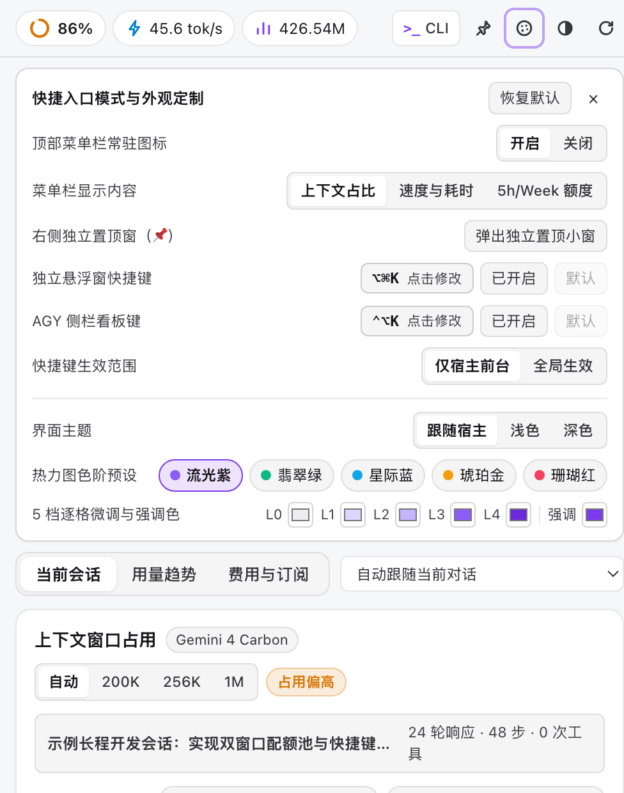

# AGY Plugins

[](#插件矩阵)
[](#快速安装)
[](#快速安装)
[](#隐私与安全原则)
[](./LICENSE)

**简体中文** | **[English](./README_EN.md)** · [插件矩阵](#插件矩阵) · [快捷命令速查](#快捷键与快捷命令速查) · [亮点与预览](#亮点与预览) · [快速安装](#快速安装) · [目录结构与新增插件](#目录结构与新增插件) · [校验与打包](#本地校验与打包) · [致谢](#致谢)

面向 **Google Antigravity 桌面端（`agy` App / IDE）** 与 **终端 `agy` CLI** 的开源插件合集仓库。

所有插件均严格遵循 Antigravity 官方 `plugin.json` 与 `sidecar_sdk` 规范构建 -- **不解包修改 `app.asar`、不注入 CDP 渲染进程、不引入第三方 `npm` 运行时依赖、100% 本地只读运行**，既保障客户端签名与自动升级完整无损，也可在 macOS / Linux / Windows 跨平台开箱即用。

---

## 插件矩阵

| 插件目录 | 插件标识 (`name`) | 版本 | 默认快捷键与快捷命令 | 核心定位 | 详细文档 |
| :--- | :--- | :--- | :--- | :--- | :--- |
| [`plugins/agy-finder`](./plugins/agy-finder) | `agy-finder` | `v0.2.4` | `⌘⇧E`（抽屉） · `⌥⌘E`（AGY 侧栏） · `/agy-finder` · `[📂]` · `agy-finder aux` | 右侧项目目录树与对话路径直达定位 | [查看 README](./plugins/agy-finder/README.md) |
| [`plugins/agy-context-viewer`](./plugins/agy-context-viewer) | `context-viewer` | `v1.7.4` | `⌥⌘K`（小窗） · `⌃⌥K`（AGY 侧栏） · `/context-viewer` · `agy-context aux` | 上下文窗口、速度、`5h + Week` 配额与 Token 看板 | [查看 README](./plugins/agy-context-viewer/README.md) |

---

## 快捷键与快捷命令速查

| 触发方式 | `AGY Finder` (`agy-finder`) | `Context & Token Viewer` (`context-viewer`) |
| :--- | :--- | :--- |
| **独立悬浮 / 抽屉** | **`⌘⇧E`** 开关右侧独立目录树抽屉（默认仅 `Antigravity` 前台生效，支持面板点击录制任意组合键、`⌘⌥E` / `⌃⇧E` / `⌘⇧Y` 预设或全球域，零冲突免辅助功能权限） | **`⌥⌘K`** 开关右侧独立置顶看板（默认仅宿主前台，支持调色盘点击录制任意组合键或全局生效）；**`⌘⇧P`** 切换置顶、**`⌘W`** 收回 |
| **AGY 右侧辅助栏** | **`⌥⌘E`**（Win / Linux：`Ctrl+Alt+E`）一键打开 / 切到 AGY 右侧辅助栏并直接显示 **目录树**（支持从 `Overview` 或跨插件状态呼出；右键标签选 `Pin Tab` 可跨会话常驻；支持自定义）；**`⌘⇧B`** / **`Ctrl+Shift+B`** 显隐辅助栏 | **`⌃⌥K`**（Win / Linux：`Ctrl+Alt+Shift+K`）一键打开 / 切到 AGY 右侧辅助栏并直接显示 **上下文看板**（支持从 `Overview` 或跨插件状态呼出；右键标签选 `Pin Tab` 可跨会话常驻；支持自定义）；顶部菜单栏支持 **左键 `<5ms` 显隐 / 右键切 3 档指标** |
| **对话斜杠 & 深链接** | 输入 **`/agy-finder`**；点击回复路径旁的 **`[📂]`** 或 [`sidecar://agy-finder/tree/`](sidecar://agy-finder/tree/) 直达目录树 | 输入 **`/context-viewer`**；或打开 [`sidecar://context-viewer/dashboard/`](sidecar://context-viewer/dashboard/) |
| **终端 CLI 快捷命令** | `agy-finder`（等同 `agy-finder toggle` 开关抽屉） · `agy-finder aux [path]`（切换 AGY 侧栏目录树）<br/>`agy-finder open [path]` · `close` · `shortcut [<combo>\|off\|reset]` · `aux-shortcut [<combo>\|off\|reset]` · `hotkey <preset>` · `status [--json]` · `quit` | `agy-context`（终端彩色进度条汇总） · `agy-context aux`（切换 AGY 侧栏看板）<br/>`agy-context float [close\|quit]` · `menubar [context\|speed\|quota\|on\|off]` · `shortcut [status\|<combo>\|reset\|off\|--global]` · `aux-shortcut [status\|<combo>\|reset\|off]` · `turns` · `json [--full]` · `web` |
| **面板内高频键位** | `↑` / `↓` 移动 · `←` / `→` 折展 · `Enter` 预览或展开 · `/` 或 `⌘/Ctrl+F` 搜索 · `⌘/Ctrl+.` 隐藏项 · `?` 快捷键 · `Esc` 关闭 | 右上角调色盘录制双快捷键与 5 套热力图配色 · 窗口上限 `自动 / 200K / 256K / 1M` 快切 · 顶部胶囊直跳核心视图 |

---

## 亮点与预览

### 1. `AGY Finder` -- 右侧项目目录树与对话路径直达

- **双保险路径定位**：内置 `rules/AGENTS.md` 让回答中的文件附带 `[📂](sidecar://agy-finder/tree/?path=...)` 快捷入口；同时仅在面板可见时按字节偏移增量读取 `transcript_full.jsonl`，提取对话提及路径芯片，对历史对话同样有效（面板收起时 `0%` CPU）。
- **双模式零冲突快捷键与轻交互**：macOS 下默认 **`⌘⇧E`** 呼出独立右侧抽屉、**`⌥⌘E`** 直达 AGY 右侧辅助栏「目录树」，均支持点击录制自定义与宿主内/全局切换（零辅助功能权限），Windows / Linux 可将 `agy-finder toggle` / `agy-finder aux` 绑定至系统快捷键；支持模糊检索、剪贴板路径直跳、行内预览弹窗与系统文件管理器定位。

<table>
  <tr>
    <td width="50%" align="center" valign="top">
      
      <br/>
      <b>对话提及芯片 + 路径栏与目录树展开高亮</b><br/>
      <sub>顶部自动聚合对话提及文件，点击即可展开目录树并高亮目标文件（支持预览 / 复制路径 / 系统定位）</sub>
    </td>
    <td width="50%" align="center" valign="top">
      
      <br/>
      <b>双快捷键自定义（<code>⌘⇧E</code> 抽屉 / <code>⌥⌘E</code> AGY 侧栏）与键盘导航</b><br/>
      <sub>独立抽屉与 AGY 右侧辅助栏均支持点击录制改键、<code>仅 AGY 内 / 全局</code> 切换与全键盘树导航</sub>
    </td>
  </tr>
</table>

### 2. `Context & Token Viewer` -- 上下文、速度、配额与费用看板

<table>
  <tr>
    <td width="50%" align="center" valign="top">
      
      <br/>
      <b>右侧独立置顶小窗（<code>📌</code> + <code>⌥⌘K</code>）</b><br/>
      <sub>与代码、Artifacts、终端同屏常驻；支持 macOS 菜单栏 3 档徽章与切换会话自动跟随</sub>
    </td>
    <td width="50%" align="center" valign="top">
      
      <br/>
      <b>双快捷键录制（<code>⌥⌘K</code> 小窗 / <code>⌃⌥K</code> AGY 侧栏）与外观定制</b><br/>
      <sub>同时自定义独立悬浮窗与 AGY 右侧辅助栏快捷键、切换仅宿主前台 / 全局生效与 5 套热力图配色</sub>
    </td>
  </tr>
  <tr>
    <td width="50%" align="center" valign="top">
      
      <br/>
      <b>用量趋势 · 桌面端 + CLI 53 周日历热力图</b><br/>
      <sub>打通桌面端与 <code>agy</code> CLI 日志，支持日 / 周 / 月 / 年 / 累计多维穿透</sub>
    </td>
    <td width="50%" align="center" valign="top">
      
      <br/>
      <b>费用与订阅 · Ultra / 家庭组与 <code>5h + Week</code> 配额池</b><br/>
      <sub>精准识别 <code>Google AI Pro / Ultra</code>，支持家庭组共享 / AA 拼车折算</sub>
    </td>
  </tr>
</table>

---

## 快速安装

> **环境要求**：本机需安装 `Node.js >= 18`。macOS 原生菜单栏、置顶小窗与独立抽屉首次编译需具备 Swift 工具链（未安装时运行 `xcode-select --install`）；Windows / Linux 下宿主内嵌 Aux Pane 与终端 CLI 完整可用。

### 方式 1：让 Antigravity Agent 协助安装（推荐首选）

直接复制下面任意一条指令发送给你的 **Antigravity Agent**，即可自动完成对应平台的安装、命令注册与状态检查：

- **安装全部插件（`agy-finder` + `agy-context-viewer`）**：

```text
请帮我安装 https://github.com/Dong-Kevin/agy-plugins 中的全部插件（macOS / Linux 运行 `bash -c "$(curl -fsSL https://raw.githubusercontent.com/Dong-Kevin/agy-plugins/main/install.sh)"`，Windows PowerShell 运行 `irm https://raw.githubusercontent.com/Dong-Kevin/agy-plugins/main/install.ps1 | iex`），安装完成后验证插件状态，并列出两个插件的快捷键与快捷命令。
```

- **仅安装单个插件（按需替换 `agy-finder` 或 `agy-context-viewer`）**：

```text
请帮我从 https://github.com/Dong-Kevin/agy-plugins 仅安装 agy-finder 插件（macOS / Linux 运行 `curl -fsSL https://raw.githubusercontent.com/Dong-Kevin/agy-plugins/main/install.sh | bash -s -- agy-finder`，Windows PowerShell 运行 `$env:AGY_PLUGIN="agy-finder"; irm https://raw.githubusercontent.com/Dong-Kevin/agy-plugins/main/install.ps1 | iex`），完成后检查可用状态并说明快捷键。
```

### 方式 2：macOS / Linux 一键安装（支持全部或单插件）

```bash
# 安装仓库内全部插件
bash -c "$(curl -fsSL https://raw.githubusercontent.com/Dong-Kevin/agy-plugins/main/install.sh)"

# 仅安装指定插件（支持目录名或 plugin.json 的 name）
curl -fsSL https://raw.githubusercontent.com/Dong-Kevin/agy-plugins/main/install.sh | bash -s -- agy-finder
curl -fsSL https://raw.githubusercontent.com/Dong-Kevin/agy-plugins/main/install.sh | bash -s -- agy-context-viewer

# 卸载全部（或追加插件名卸载指定插件）
curl -fsSL https://raw.githubusercontent.com/Dong-Kevin/agy-plugins/main/install.sh | bash -s -- --uninstall
```

### 方式 3：Windows PowerShell 一键安装

```powershell
# 安装全部插件
irm https://raw.githubusercontent.com/Dong-Kevin/agy-plugins/main/install.ps1 | iex

# 仅安装指定插件（如 agy-finder 或 agy-context-viewer）
$env:AGY_PLUGIN="agy-finder"; irm https://raw.githubusercontent.com/Dong-Kevin/agy-plugins/main/install.ps1 | iex
```

### 方式 4：克隆仓库后本地安装或通过 `agy` CLI 安装

```bash
git clone https://github.com/Dong-Kevin/agy-plugins.git
cd agy-plugins

# 查看可用插件列表
./install.sh --list

# 安装全部或指定插件
./install.sh
./install.sh agy-finder

# Windows PowerShell：
# .\install.ps1 -List
# .\install.ps1 -Plugin agy-finder, agy-context-viewer

# 或使用官方 agy CLI 安装单个插件子目录：
agy plugin install ./plugins/agy-finder
agy plugin install ./plugins/agy-context-viewer
```

### 方式 5：通过 `plugins.json` 挂载或下载离线包

可将本仓库 `plugins/` 目录直接注册到全局 `~/.gemini/config/plugins.json` 或工作区 `.agents/plugins.json`（参考 [官方 JSON 配置文档](https://antigravity.google/docs/plugins)）：

```json
{
  "entries": [
    { "path": "/path/to/agy-plugins/plugins" }
  ]
}
```

也可以前往 [Releases](https://github.com/Dong-Kevin/agy-plugins/releases) 下载对应插件的离线压缩包与 `.sha256` 校验文件后解压安装。

---

## 目录结构与新增插件

```text
agy-plugins/
├── README.md                          # 仓库中文总览
├── README_EN.md                       # 仓库英文总览
├── AGENTS.md                          # 仓库开发、安全与发布约束
├── ROADMAP.md                         # 仓库里程碑与验证记录
├── LICENSE                            # MIT License
├── install.sh                         # 统一安装 / 列表 / 卸载脚本（macOS / Linux）
├── install.ps1                        # 统一安装 / 列表 / 卸载脚本（Windows PowerShell）
├── plugins/
│   ├── agy-finder/                    # 项目目录树插件（v0.2.4）
│   └── agy-context-viewer/            # 上下文与 Token 看板插件（context-viewer v1.7.4）
└── scripts/
    ├── verify.mjs                     # 全仓规范、隐私、PNG 元数据、子插件与安装器门禁
    ├── package-all.mjs                # 零依赖构建各插件独立 Release ZIP 与 SHA-256
    └── pre-push                       # 仓库管理的 Git pre-push 门禁脚本
```

### 新增插件清单（Contributor Checklist）

1. 在 `plugins/<plugin-dir>/` 下按官方结构创建 `plugin.json`（`repository` 统一填写 `"https://github.com/Dong-Kevin/agy-plugins"`，`homepage` 指向 `.../tree/main/plugins/<plugin-dir>`）、`assets/logo.svg`、`README.md` 与跨平台 `install.sh` / `install.ps1`。
2. 确保 `plugin.json` 的 `name` 与内部 `skills/<skill>/` 名称在全仓内全局唯一。
3. Sidecar 前端自定义 CSS 变量使用独立命名空间前缀，避免与宿主注入的 `--muted`、`--accent`、`--border` 等变量冲突，且不得引入外部 `http(s)://` 静态资源。
4. 为新插件补充 `plugins/<plugin-dir>/scripts/verify.mjs`，并同步更新 `scripts/package-all.mjs`。
5. 运行下方全仓校验与打包命令，确认全部检查通过后再提交。

---

## 本地校验与打包

```bash
# 运行全仓结构、官方 Schema、隐私脱敏、PNG 元数据、Git 身份及所有子插件自检
node scripts/verify.mjs --strict-git-identity

# 构建全部插件的独立发行包至 dist/ 目录并校验 SHA-256
node scripts/package-all.mjs
```

> 启用仓库管理的推送前隐私门禁：`ln -sf ../../scripts/pre-push .git/hooks/pre-push`（本仓库已默认链接）。

---

## 隐私与安全原则

- **零外部运行时依赖**：仅使用 `Node.js >= 18` 标准库与操作系统原生能力。
- **100% 本地只读**：所有会话日志与状态采集仅在本地完成，不上传对话内容、文件路径、凭据或任何遥测数据。
- **零侵入宿主**：不修改 `Antigravity.app` 安装包或全局 `~/.gemini/config/config.json`。
- **严格隐私门禁**：所有源码、文档与截图均通过 `scripts/verify.mjs` 的本地路径、凭据模式、PNG 元数据块与 Git `noreply` 提交身份校验。

---

## 致谢

- `plugins/agy-context-viewer` 在构思之初深受开源项目 **[elviscjn-cjn/antigravity-context-viewer](https://github.com/elviscjn-cjn/antigravity-context-viewer)** 的启发，谨向原作者致以诚挚感谢！

---

## License

基于 [MIT License](./LICENSE) 开源。
