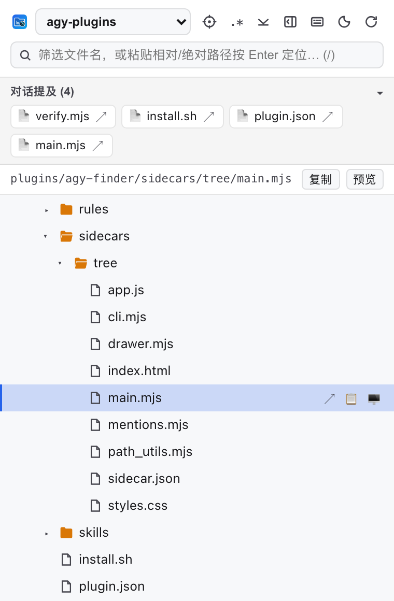
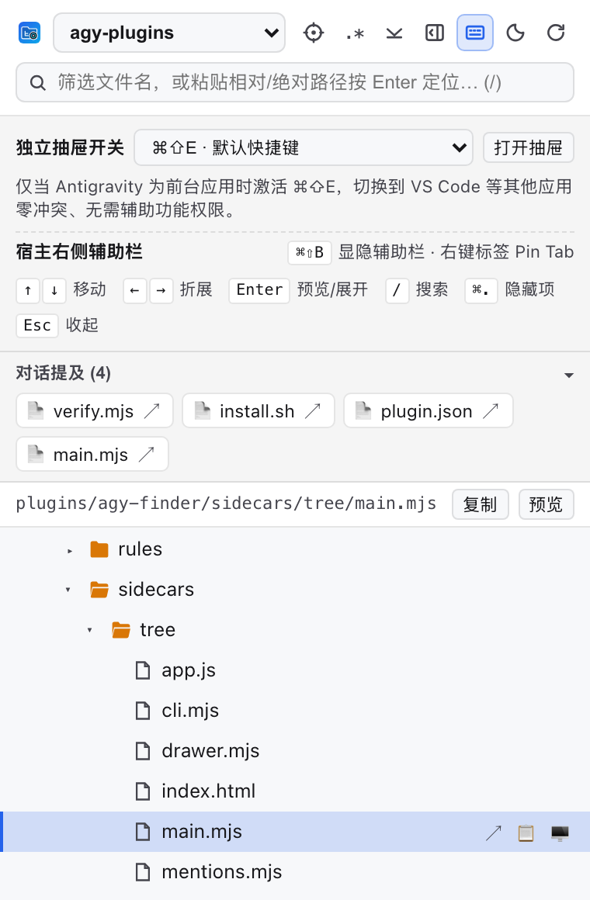
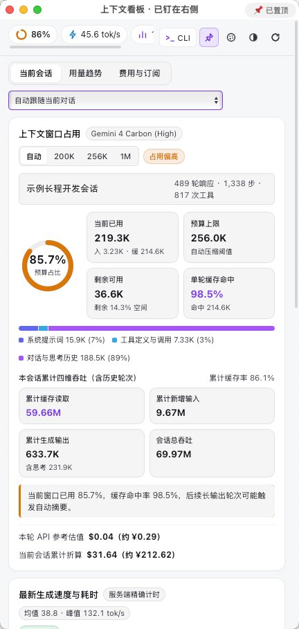
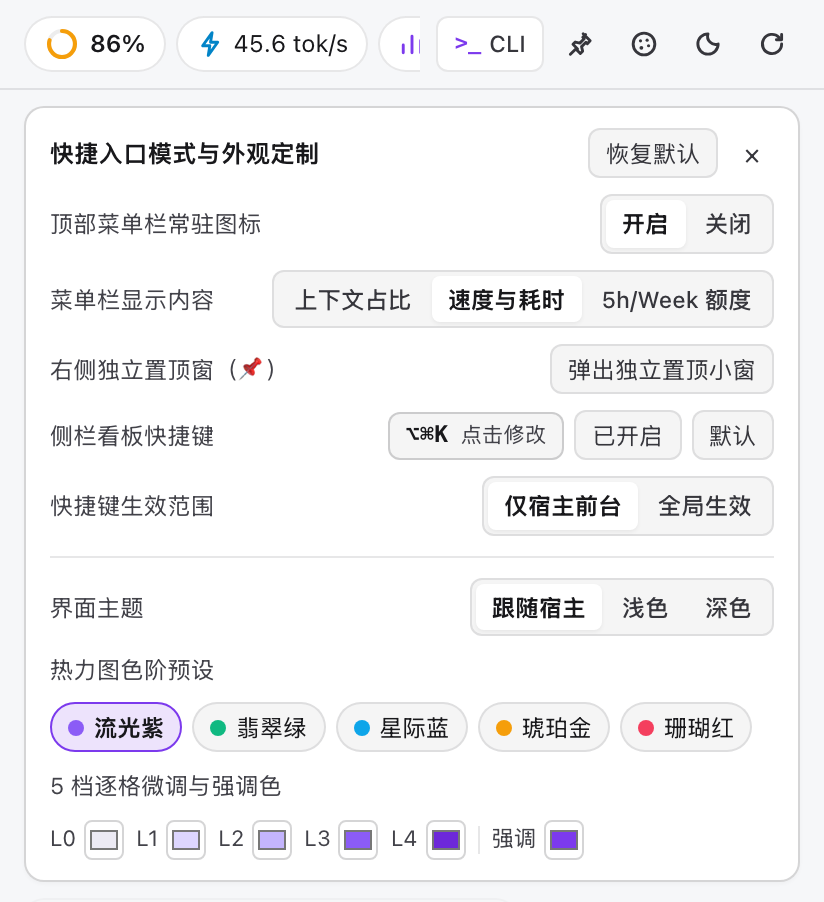
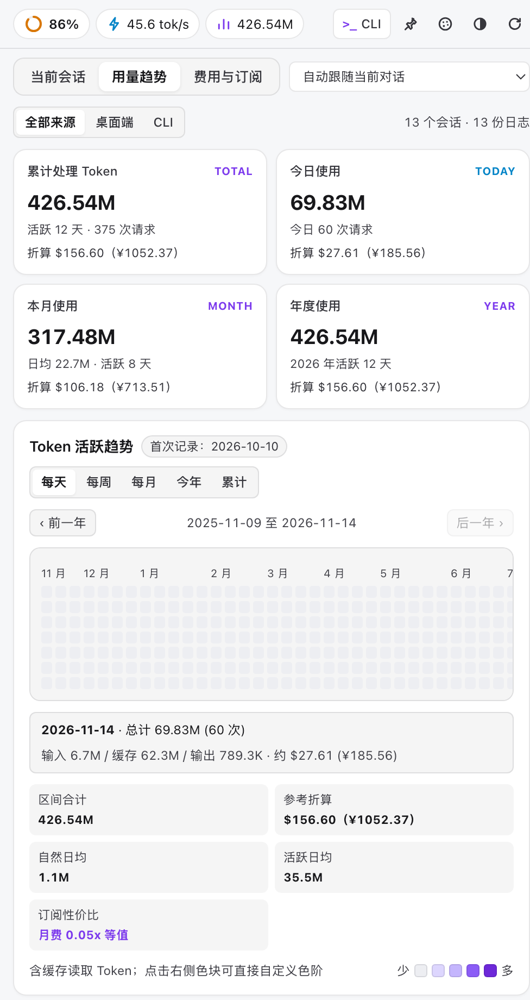
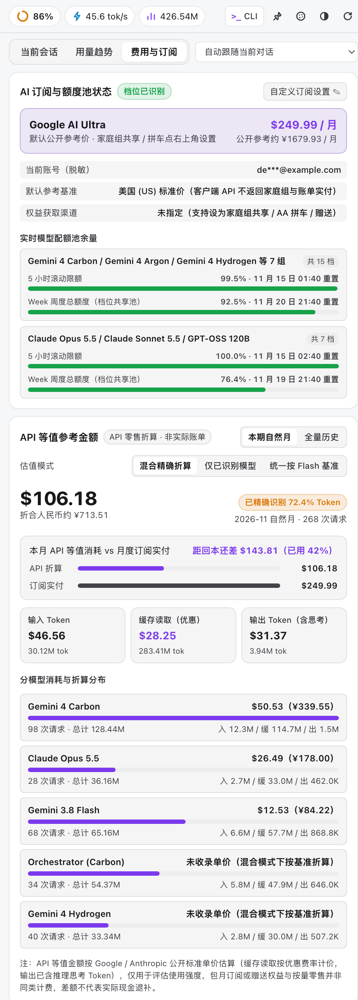

# AGY Plugins

[](#plugin-catalog)
[](#quick-install)
[](#quick-install)
[](#privacy--security)
[](./LICENSE)

**[简体中文](./README.md)** | **English** · [Plugin Catalog](#plugin-catalog) · [Shortcuts & Commands](#shortcuts--quick-commands) · [Highlights & Previews](#highlights--previews) · [Quick Install](#quick-install) · [Structure & Adding Plugins](#repository-structure--adding-plugins) · [Verification](#local-verification--packaging) · [Acknowledgements](#acknowledgements)

An open-source plugin collection for **Google Antigravity Desktop (`agy` App / IDE)** and the **`agy` CLI**.

Every plugin is built strictly on Antigravity's official `plugin.json` and `sidecar_sdk` specifications — **zero `app.asar` patching, zero CDP injection, zero external `npm` runtime dependencies, and 100% local read-only telemetry**, keeping client signatures and updates intact across **macOS, Linux, and Windows**.

---

## Plugin Catalog

| Directory | Plugin `name` | Version | Default Shortcuts & Quick Commands | Purpose | Docs |
| :--- | :--- | :--- | :--- | :--- | :--- |
| [`plugins/agy-finder`](./plugins/agy-finder) | `agy-finder` | `v0.1.0` | `⌘⇧E` (drawer) · `/agy-finder` · `[📂]` · `agy-finder toggle` | Right-side Project File Tree & Instant Path Reveal | [README](./plugins/agy-finder/README_EN.md) |
| [`plugins/agy-context-viewer`](./plugins/agy-context-viewer) | `context-viewer` | `v1.6.3` | `⌥⌘K` (window) · Left-click Menu Bar · `/context-viewer` · `agy-context` | Context Window, Speed, `5h + Weekly` Quotas & Token Analytics | [README](./plugins/agy-context-viewer/README_EN.md) |

---

## Shortcuts & Quick Commands

| Trigger | `AGY Finder` (`agy-finder`) | `Context & Token Viewer` (`context-viewer`) |
| :--- | :--- | :--- |
| **macOS Panel Hotkeys** | **`⌘⇧E`** toggles the right-side file tree drawer (active only when `Antigravity` is frontmost, zero conflicts, no Accessibility prompt; switchable via `⌨` to `⌘⌥E` / `⌃⇧E` / `⌘⇧Y` / `off`) | **`⌥⌘K`** toggles the right-side pinned floating window (Host-frontmost by default, click-to-record custom chords or global scope); **`⌘⇧P`** toggles pin, **`⌘W`** closes |
| **Host Pane & Menu Bar** | **`⌘⇧B`** (macOS) / **`Ctrl+Shift+B`** (Win / Linux) toggles Antigravity's Right Aux Pane | macOS Menu Bar badge **left-click (`<5ms`) toggles window**, **right-click switches 3 live metrics / pin**; **`⌘⇧B`** / **`Ctrl+Shift+B`** for Aux Pane; **`Ctrl+Alt+K`** inside dashboard on Win / Linux |
| **In-Chat Slash & Deep Links** | Type **`/agy-finder`**; click `[📂]` next to any file reference or [`sidecar://agy-finder/tree/`](sidecar://agy-finder/tree/) | Type **`/context-viewer`**; or open [`sidecar://context-viewer/dashboard/`](sidecar://context-viewer/dashboard/) |
| **Terminal CLI Commands** | `agy-finder` (alias for `agy-finder toggle`; bind to `Ctrl+Shift+E` on Win / Linux)<br/>`agy-finder open [path]` · `close` · `hotkey <preset>` · `status [--json]` · `quit` | `agy-context` (rich ANSI terminal dashboard)<br/>`agy-context float [close\|quit]` · `menubar [context\|speed\|quota\|on\|off]` · `shortcut [status\|<combo>\|reset\|off\|--global]` · `turns` · `json [--full]` · `web` |
| **In-Panel Actions** | `↑` / `↓` move · `←` / `→` collapse/expand · `Enter` preview/toggle · `/` or `⌘/Ctrl+F` search · `⌘/Ctrl+.` dotfiles · `?` shortcuts · `Esc` dismiss | Palette drawer click-to-record shortcut & 5 heatmap themes · Ceiling switcher (`Auto / 200K / 256K / 1M`) · Top capsules jump to views |

---

## Highlights & Previews

### 1. `AGY Finder` — Workspace File Tree & Instant Reveal

- **Dual-Safety Reveal**: Bundled `rules/AGENTS.md` pairs `[file](file:///...)` preview links with compact `[📂](sidecar://agy-finder/tree/?path=...)` deep links, while byte-offset incremental `transcript_full.jsonl` parsing surfaces clickable **Mention** chips even on older threads (`0%` CPU when hidden).
- **Conflict-Free Shortcuts & Actions**: Native macOS **`⌘⇧E`** toggles the right-side drawer only when `Antigravity` is frontmost (zero Accessibility permission prompts); Windows / Linux users can bind `agy-finder toggle` to a global hotkey; includes fuzzy search, clipboard jump, inline preview modal, and OS file manager reveal.

<table>
  <tr>
    <td width="50%" align="center" valign="top">
      
      <br/>
      <b>Mention Chips + Path Bar & Highlighted Tree Reveal</b><br/>
      <sub>Aggregates mentioned workspace files at the top; one click expands folders, selects the target, and offers preview / copy / OS reveal</sub>
    </td>
    <td width="50%" align="center" valign="top">
      
      <br/>
      <b>Conflict-Free Hotkey Presets (<code>⌘⇧E</code>) & Keyboard Nav</b><br/>
      <sub>Switch between <code>⌘⇧E</code> / <code>⌘⌥E</code> / <code>⌃⇧E</code> / <code>⌘⇧Y</code>, host <code>⌘⇧B</code> Aux Pane, and full keyboard tree navigation</sub>
    </td>
  </tr>
</table>

### 2. `Context & Token Viewer` — Context, Speed, Quotas & Cost Dashboard

<table>
  <tr>
    <td width="50%" align="center" valign="top">
      
      <br/>
      <b>Right-Side Pinned Floating Window (<code>📌</code> + <code>⌥⌘K</code>)</b><br/>
      <sub>Stays pinned beside your editor, Artifacts, and terminal; pairs with a 3-mode macOS Menu Bar indicator</sub>
    </td>
    <td width="50%" align="center" valign="top">
      
      <br/>
      <b>Quick Entry, <code>⌥⌘K</code> Shortcut Recorder & Themes</b><br/>
      <sub>Toggle Menu Bar badge, record custom toggle chords, pick host-only/global scope, and customize 5 heatmap palettes</sub>
    </td>
  </tr>
  <tr>
    <td width="50%" align="center" valign="top">
      
      <br/>
      <b>Usage Trends · Desktop + CLI 53-Week Heatmap</b><br/>
      <sub>Unified Desktop & <code>agy</code> CLI telemetry across Daily, Weekly, Monthly, Yearly, and Cumulative charts</sub>
    </td>
    <td width="50%" align="center" valign="top">
      
      <br/>
      <b>Cost & Quotas · Ultra / Family Sharing & Dual Pools</b><br/>
      <sub>Detects <code>Google AI Pro / Ultra</code>, supports Family Group / split-billing, and tracks <code>5h + Weekly</code> pools</sub>
    </td>
  </tr>
</table>

---

## Quick Install

> **Prerequisites**: `Node.js >= 18`. On macOS, native Menu Bar / floating window / drawer compilation requires Xcode Command Line Tools (`xcode-select --install`). On Windows / Linux, the embedded Aux Pane Sidecar and terminal CLIs work out of the box.

### Option 1: Ask Your Antigravity Agent to Install (Recommended)

Copy either prompt below directly into **Antigravity** and let the agent install, verify, and configure the CLI commands for your OS:

- **Install All Plugins (`agy-finder` + `agy-context-viewer`)**:

```text
Please install all plugins from https://github.com/Dong-Kevin/agy-plugins (on macOS/Linux run `bash -c "$(curl -fsSL https://raw.githubusercontent.com/Dong-Kevin/agy-plugins/main/install.sh)"`, on Windows PowerShell run `irm https://raw.githubusercontent.com/Dong-Kevin/agy-plugins/main/install.ps1 | iex`), verify the installation status, and summarize the shortcuts and quick commands for both plugins.
```

- **Install a Single Plugin (swap `agy-finder` or `agy-context-viewer` as needed)**:

```text
Please install only the agy-finder plugin from https://github.com/Dong-Kevin/agy-plugins (on macOS/Linux run `curl -fsSL https://raw.githubusercontent.com/Dong-Kevin/agy-plugins/main/install.sh | bash -s -- agy-finder`, on Windows PowerShell run `$env:AGY_PLUGIN="agy-finder"; irm https://raw.githubusercontent.com/Dong-Kevin/agy-plugins/main/install.ps1 | iex`), verify it is active, and list its shortcuts and CLI commands.
```

### Option 2: macOS / Linux One-Liner (All or Single Plugin)

```bash
# Install all plugins
bash -c "$(curl -fsSL https://raw.githubusercontent.com/Dong-Kevin/agy-plugins/main/install.sh)"

# Install a single plugin (by folder name or manifest name)
curl -fsSL https://raw.githubusercontent.com/Dong-Kevin/agy-plugins/main/install.sh | bash -s -- agy-finder
curl -fsSL https://raw.githubusercontent.com/Dong-Kevin/agy-plugins/main/install.sh | bash -s -- agy-context-viewer

# Uninstall all (or pass plugin names)
curl -fsSL https://raw.githubusercontent.com/Dong-Kevin/agy-plugins/main/install.sh | bash -s -- --uninstall
```

### Option 3: Windows PowerShell One-Liner

```powershell
# Install all plugins
irm https://raw.githubusercontent.com/Dong-Kevin/agy-plugins/main/install.ps1 | iex

# Install specific plugin(s)
$env:AGY_PLUGIN="agy-finder"; irm https://raw.githubusercontent.com/Dong-Kevin/agy-plugins/main/install.ps1 | iex
```

### Option 4: Git Clone or Official `agy` CLI

```bash
git clone https://github.com/Dong-Kevin/agy-plugins.git
cd agy-plugins

./install.sh --list
./install.sh                        # Install all plugins (or pass plugin names)

# Windows PowerShell:
# .\install.ps1 -List
# .\install.ps1 -Plugin agy-finder, agy-context-viewer

# Or install individual plugin folders via official agy CLI:
agy plugin install ./plugins/agy-finder
agy plugin install ./plugins/agy-context-viewer
```

### Option 5: Register via `plugins.json` or Offline Releases

Add the `plugins/` directory to `~/.gemini/config/plugins.json` or `.agents/plugins.json`:

```json
{
  "entries": [
    { "path": "/path/to/agy-plugins/plugins" }
  ]
}
```

Offline ZIP packages and `.sha256` checksums are also published under [Releases](https://github.com/Dong-Kevin/agy-plugins/releases).

---

## Repository Structure & Adding Plugins

```text
agy-plugins/
├── README.md                          # Chinese repository overview
├── README_EN.md                       # English repository overview
├── AGENTS.md                          # Monorepo engineering & release guardrails
├── ROADMAP.md                         # Repository milestones & verification log
├── LICENSE                            # MIT License
├── install.sh                         # Unified installer / lister / uninstaller (macOS / Linux)
├── install.ps1                        # Unified installer / lister / uninstaller (Windows PowerShell)
├── plugins/
│   ├── agy-finder/                    # Project file tree plugin (v0.1.0)
│   └── agy-context-viewer/            # Context & token analytics plugin (context-viewer v1.6.3)
└── scripts/
    ├── verify.mjs                     # Repo-wide schema, privacy, PNG metadata, plugin & installer suite
    ├── package-all.mjs                # Zero-dependency Release ZIP + SHA-256 packager
    └── pre-push                       # Repository-managed Git pre-push privacy gate
```

### Adding a New Plugin

1. Create `plugins/<plugin-dir>/` following the official layout (`plugin.json` with `"repository": "https://github.com/Dong-Kevin/agy-plugins"`, `"homepage"` pointing to `.../tree/main/plugins/<plugin-dir>`, `assets/logo.svg`, `README.md`, `install.sh`, `install.ps1`).
2. Keep `plugin.json` `name` and bundled `skills/<name>/` names globally unique across `plugins/*`.
3. Namespace all custom CSS variables in sidecar UIs (e.g., `--af-*`, `--cv-*`) and never load external `http(s)://` assets in HTML/CSS.
4. Include `plugins/<plugin-dir>/scripts/verify.mjs` and register the plugin in `scripts/package-all.mjs`.
5. Run the repository verification and packaging suites before committing.

---

## Local Verification & Packaging

```bash
# Run repo-wide structure, schema, privacy, PNG metadata, Git identity & all plugin tests
node scripts/verify.mjs --strict-git-identity

# Build standalone Release ZIPs + SHA-256 files into dist/
node scripts/package-all.mjs
```

---

## Privacy & Security

- **Zero External Runtime Dependencies**: Built strictly with `Node.js >= 18` standard library and OS-native components.
- **100% Local Read-Only**: Conversation archives and status endpoints are processed strictly locally; zero prompts, paths, or credentials leave the machine.
- **Non-Intrusive Host Boundary**: Never modifies `Antigravity.app` binaries or `~/.gemini/config/config.json`.
- **Automated Gate**: `scripts/verify.mjs` enforces path/credential/PNG-chunk/Git-noreply checks across the entire repository.

---

## Acknowledgements

- `plugins/agy-context-viewer` was originally inspired by **[elviscjn-cjn/antigravity-context-viewer](https://github.com/elviscjn-cjn/antigravity-context-viewer)** — sincere thanks to the original author for pioneering Antigravity context and quota visualization!

---

## License

Licensed under the [MIT License](./LICENSE).
