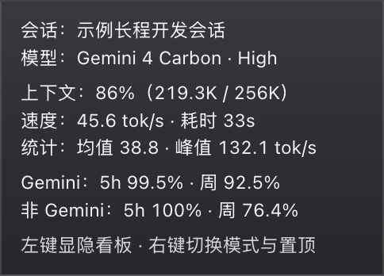
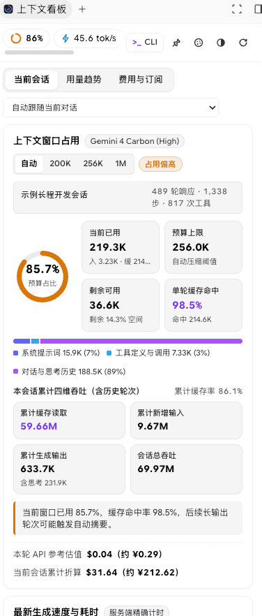
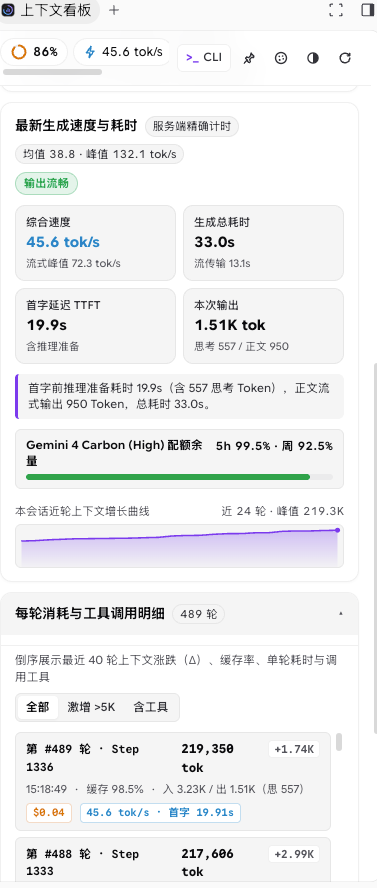
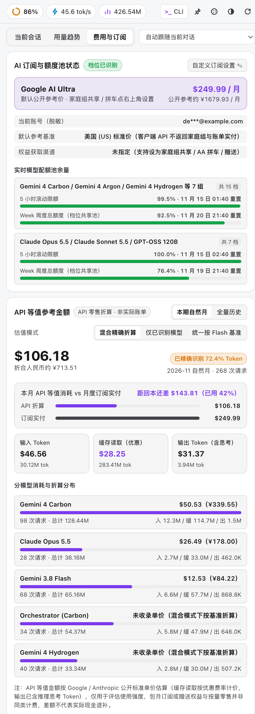
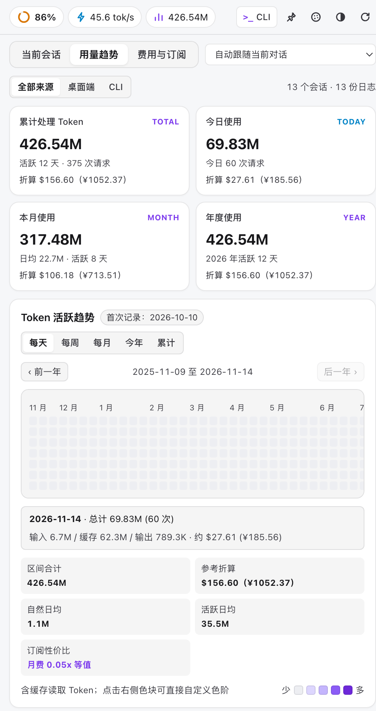
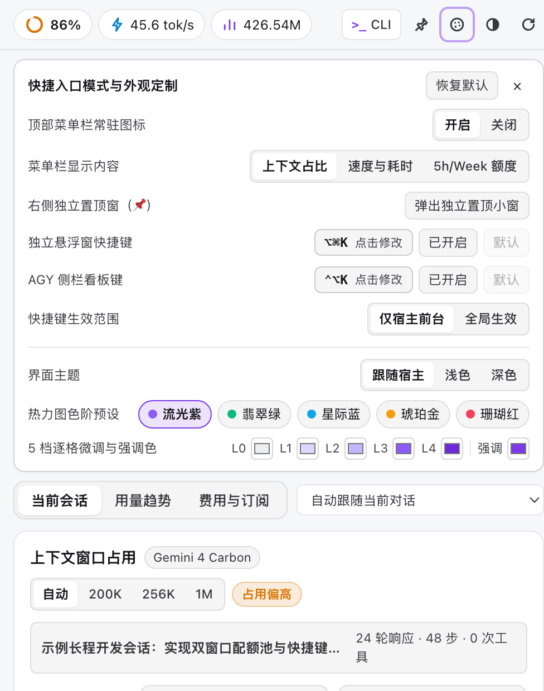
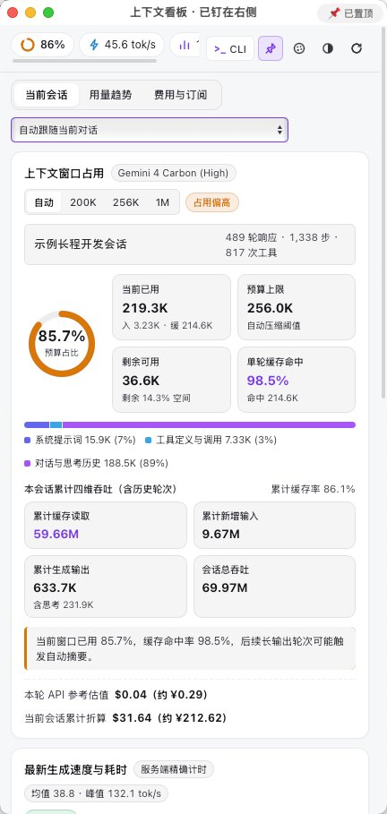

# Antigravity Context & Token Viewer（`context-viewer`）

实时观测 **Google Antigravity Desktop App / IDE**（同步汇总本机 `agy` CLI 历史）上下文窗口占比、10 类光谱构成、会话与分模型缓存率、生成速度（TTFT / `tok/s`）、53 周热力图、毛玻璃与 OLED 主题、中英双语界面、**一键安全自动更新**，以及 **Gemini / 非 Gemini（Claude · GPT）双池 5h + 周额度** -- 零外部依赖、零客户端文件改动、纯本地只读统计（`agy` CLI 与 Solo 轻量实时状态栏推荐使用同仓 [agy-cli-hud](../agy-cli-hud/README.md)）。

**简体中文** | [English](README_EN.md) | [合集主页](../../README.md)

---

## Agent 一句话安装

复制下面这段话直接发给 Antigravity，即可自动完成安装并验证状态：

```text
请帮我安装 Antigravity Context & Token Viewer 插件（来自 https://github.com/Dong-Kevin/agy-plugins ：macOS / Linux 运行 `bash -c "$(curl -fsSL https://raw.githubusercontent.com/Dong-Kevin/agy-plugins/main/plugins/agy-context-viewer/install.sh)"`，Windows PowerShell 运行 `irm https://raw.githubusercontent.com/Dong-Kevin/agy-plugins/main/plugins/agy-context-viewer/install.ps1 | iex`），安装后测试 `agy-context menubar status` 并列出快捷键说明。
```

<details>
<summary>手动命令行安装 / 热更新 / 卸载（macOS · Linux · Windows）</summary>

```bash
# macOS / Linux -- 安装或原地热更新
bash -c "$(curl -fsSL https://raw.githubusercontent.com/Dong-Kevin/agy-plugins/main/plugins/agy-context-viewer/install.sh)"

# 卸载
bash -c "$(curl -fsSL https://raw.githubusercontent.com/Dong-Kevin/agy-plugins/main/plugins/agy-context-viewer/install.sh)" -- --uninstall
```

```powershell
# Windows PowerShell -- 安装或热更新（卸载加 .\plugins\agy-context-viewer\install.ps1 -Uninstall）
irm https://raw.githubusercontent.com/Dong-Kevin/agy-plugins/main/plugins/agy-context-viewer/install.ps1 | iex
```

- 也可直接从 [Releases](https://github.com/Dong-Kevin/agy-plugins/releases) 下载 `context-viewer-v1.10.0.zip` 解压后运行 `./install.sh`（或 `agy plugin install ./plugins/agy-context-viewer`）。
- 仅通过 `agy plugin install` 安装时，CLI 入口为 `node ~/.gemini/config/plugins/context-viewer/sidecars/dashboard/cli.mjs`。

</details>

---

## 快捷键与自定义位置

| 触发方式 | 默认按键 / 操作 | 说明 | 自定义位置 |
| :--- | :--- | :--- | :--- |
| **独立置顶悬浮窗（macOS）** | **`⌥⌘K`**（`⌘⇧P` 置顶 · `⌘W` 关闭） | 独立窗口呼出与隐藏，点击顶部 **`📌`** 同效 | **顶部 `📌` 右侧调色盘按钮** → **`⌥⌘K 点击修改`**（支持 **`仅宿主前台 / 全局生效`**）<br/>CLI：`agy-context shortcut [opt+cmd+l\|reset\|off]` |
| **AGY 右侧栏直达** | **`⌃⌥K`**（Win/Linux `Ctrl+Alt+Shift+K`） | 从任何页面或跨插件直接唤醒并切到看板 | **调色盘按钮** → **`⌃⌥K 点击修改`**；标签页 **右键 → `Pin Tab`** 可跨对话常驻<br/>CLI：`agy-context aux-shortcut [ctrl+opt+l\|reset\|off]` |
| **macOS 顶部菜单栏** | **左键 `<5ms` 显隐 · 右键切模式/置顶** | 轮切 `◈ 86%` / `⚡ 46t/s·33s` / `⏳ 5h·周` 3 种状态，悬停看完整摘要 | **调色盘按钮** → `顶部菜单栏常驻图标` / `菜单栏显示内容`<br/>CLI：`agy-context menubar [context\|speed\|quota\|off]` |
| **宿主与对话入口** | **`⌘⇧B`**（Win/Linux `Ctrl+Shift+B`）<br/>**`/context-viewer`** | 切换 Antigravity 原生右侧辅助栏显隐；对话输入 Slash 命令直达 | 调色盘内可切换 **自动 / 浅 / 深 / OLED 纯黑主题**、**毛玻璃开关**、**中 / 英双语** 与 **5 套热力图配色**（`L0-L4` 可逐格微调） |
| **一键安全自动更新** | **顶栏下载图标** / **调色盘版本行** / **底部零 CLS 浮层** | 检查官方 GitHub Release，强制校验 HTTPS 白名单、`.sha256` 与 CRC-32 后临时目录原子替换并自动三端热重载 | 发现新版本时顶栏亮起提醒红点；本地 `.git` 开发仓自动防误覆盖 |
| **订阅分摊与拼车折算** | -- | 支持按月费折扣、家庭组共享或 AA 拼车比例计算净成本 | **`费用与订阅`** 标签页右上角 → **`自定义订阅设置 ✎`** |

<details>
<summary>常用 <code>agy-context</code> 终端命令速查</summary>

```bash
agy-context                    # 终端 ANSI 看板（上下文占比、冷热启动、速度、重度 Top 3、Swarm 整树与双池配额）
agy-context statusline install # 为 agy CLI 开启底部原生实时状态栏（模型、水位%、冷启动 ❄C 预警、tok/s、费用与双池配额）
agy-context watch              # 终端实时盯盘面板（适配 tmux 分屏，自动跟随当前会话与整树更新）
agy-context aux                # 唤醒 / 切至 Antigravity 右侧辅助栏看板
agy-context float              # 显隐独立置顶小窗（close 关闭 / quit 退出守护进程）
agy-context menubar quota      # 菜单栏切为配额剩余（可选 context / speed / quota / on / off / status）
agy-context quota-rpc off      # 开启「零额度 RPC 模式」（禁用 GetUserStatus/Quota 宿主查询，纯本地统计；也可用 AGY_CV_ZERO_QUOTA_RPC=1）
agy-context turns [--prompts]  # 查看近 40 轮上下文 Δ、思考占比、整请求吞吐与工具调用，或按 Prompt 诊断冷/热启动
agy-context heavy              # 查看当前会话上下文重度消耗 Top 10 排行
agy-context tree               # 查看当前会话 Swarm / Subagent 多代理整树聚合统计
agy-context compact [--full]   # 查看当前会话上下文压缩历史与摘要原文
agy-context events             # 查看跨会话 429 / 安全过滤浪费 / 重试与 requestId / 灰度路由取证及按项目消耗 Top 10
agy-context pricing [--sync|--reset] # 离线查看模型费率与调价预告（--sync 手动同步官方定价，--reset 恢复内置）
agy-context web                # 启动 127.0.0.1:18970 独立 Web 看板并打开浏览器
agy-context json               # 输出结构化汇总 JSON（追加 --full 返回完整原始数据）
```

</details>

---

## 核心功能与界面预览

- **当前会话诊断**：动态跟随宿主实时上下文窗口上限（如 `256K` / `512K` / `840K` / `1M`，服务端扩容或回退自动同步；离线时优先复用只读 SQLite 缓存阈值），展示 `repo@branch`、`/btw` 分支去重、System / Tools / Messages 拆分、TTFT / 流式 `tok/s`、**总上下文 vs 缓存读取双折线**、**Prompt 冷/热启动诊断**、**重度消耗 Top 10**、**压缩历史与摘要抽屉**以及 **Swarm / Subagent 整树聚合**。
- **多端汇总与取证洞察**：合并统计 Antigravity 桌面端、IDE 与 `agy` CLI 的 **53 周热力图（含单日分模型明细）**、**今日/昨日 24 小时柱图**、**按项目消耗排行**、**429 / 安全过滤浪费 / 灰度路由取证**，以及 **Gemini / 非 Gemini（Claude · GPT）** 双配额池 5h + 周额度余量与 **Prompt 缓存已省金额**。

<p align="center">
  <strong>macOS 顶部菜单栏常驻与悬停详情：</strong><br/>
  
  &nbsp;&nbsp;
  
</p>

<table>
  <tr>
    <td align="center" width="33%">
      <strong>当前会话 · 上下文透视</strong><br/>
      
    </td>
    <td align="center" width="33%">
      <strong>生成速度与逐轮增幅</strong><br/>
      
    </td>
    <td align="center" width="33%">
      <strong>双池配额与 API 折算</strong><br/>
      
    </td>
  </tr>
  <tr>
    <td align="center">
      <strong>53 周趋势与历史热力图</strong><br/>
      
    </td>
    <td align="center">
      <strong>快捷键与配色定制抽屉</strong><br/>
      
    </td>
    <td align="center">
      <strong>独立置顶小窗（<code>📌</code>）</strong><br/>
      
    </td>
  </tr>
</table>

---

## 致谢

本项目在构思之初深受开源项目 **[elviscjn-cjn/antigravity-context-viewer](https://github.com/elviscjn-cjn/antigravity-context-viewer)** 的启发 -- 该项目率先探索了 Google Antigravity 客户端的上下文窗口构成透视、Token 活跃热力图与模型配额可视化方案，为我们梳理核心观测指标与看板呈现提供了极具价值的参考。在此向原作者的开创性探索致以诚挚感谢与敬意！

站在社区先行者的肩膀上，`agy-context-viewer` 遵循 Antigravity 官方 `plugin.json` + `sidecar_sdk` 插件体系从零全新编写（免修改客户端 `app.asar`、零签名破坏），并进一步构建了 macOS 原生顶部菜单栏三档常驻徽章、切换对话自动跟随、屏幕右侧独立置顶小窗（`📌`）、`5h + Week` 双维度共享额度池、`Google AI Ultra` 与家庭组订阅折算以及 `agy` CLI 终端套件。

---

## 兼容与校验

- **运行环境**：依赖 `Node.js >= 18`；macOS Apple Silicon 原生菜单栏、悬浮窗与真实宿主交互已完整实测，Windows / Linux 支持 AGY 原生 Sidecar、独立 Web UI 与 `agy-context` CLI。
- **本地校验与协议**：`node plugins/agy-context-viewer/scripts/verify.mjs`；基于 [MIT License](./LICENSE) 开源。
