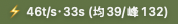
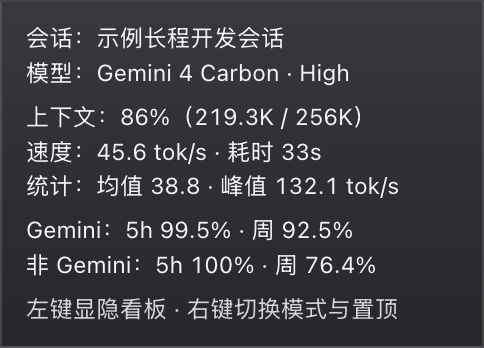
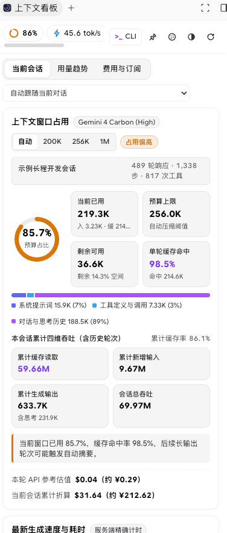
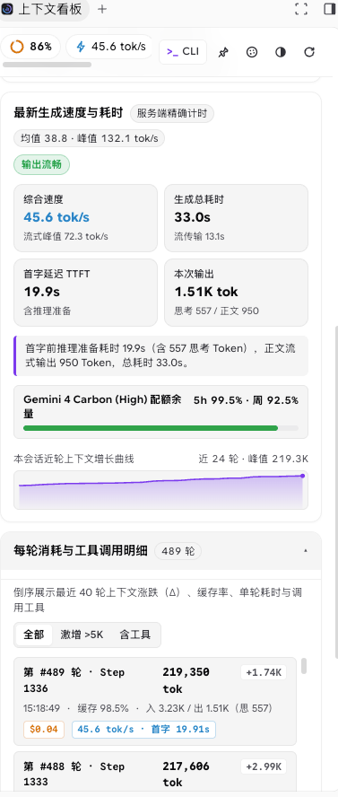
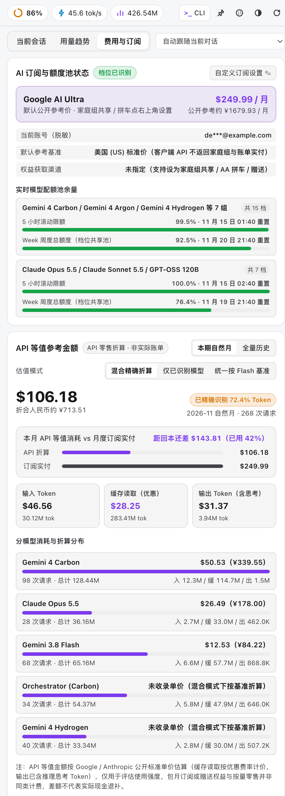
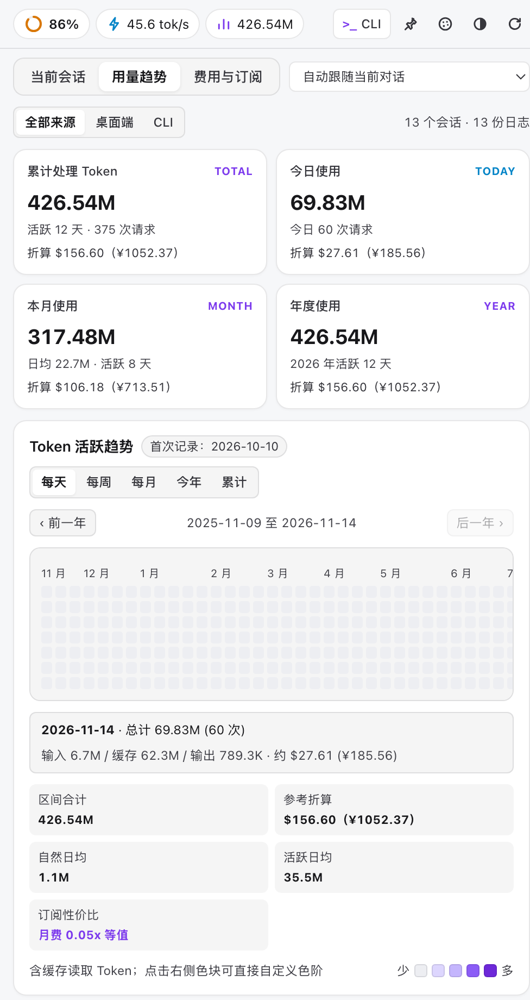
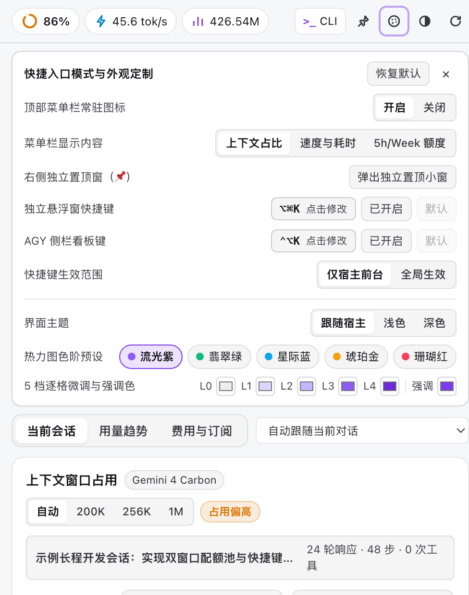
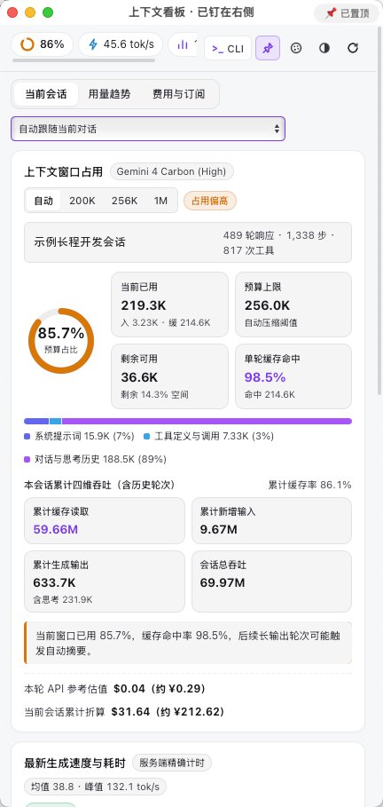

# Antigravity Context & Token Viewer (`context-viewer`)

Live visibility into **Google Antigravity** (Desktop & `agy` CLI) context window usage, streaming speed (TTFT / `tok/s`), per-turn growth, 53-week activity heatmaps, and unified **Gemini / Non-Gemini (Claude · GPT) 5h + Weekly quota pools** -- zero external dependencies, zero client patching, 100% local read-only telemetry.

[简体中文](README.md) | **English** | [Monorepo Home](../../README_EN.md)

---

## One-Sentence Agent Install

Send this prompt to Antigravity to install and verify automatically:

```text
Please install the Antigravity Context & Token Viewer plugin from https://github.com/Dong-Kevin/agy-plugins (on macOS/Linux run `bash -c "$(curl -fsSL https://raw.githubusercontent.com/Dong-Kevin/agy-plugins/main/plugins/agy-context-viewer/install.sh)"`, on Windows PowerShell run `irm https://raw.githubusercontent.com/Dong-Kevin/agy-plugins/main/plugins/agy-context-viewer/install.ps1 | iex`), test `agy-context menubar status`, and summarize its keyboard shortcuts.
```

<details>
<summary>Manual CLI Install / Hot Upgrade / Uninstall (macOS · Linux · Windows)</summary>

```bash
# macOS / Linux -- install or hot-upgrade
bash -c "$(curl -fsSL https://raw.githubusercontent.com/Dong-Kevin/agy-plugins/main/plugins/agy-context-viewer/install.sh)"

# Uninstall
bash -c "$(curl -fsSL https://raw.githubusercontent.com/Dong-Kevin/agy-plugins/main/plugins/agy-context-viewer/install.sh)" -- --uninstall
```

```powershell
# Windows PowerShell -- install or hot-upgrade (uninstall via .\plugins\agy-context-viewer\install.ps1 -Uninstall)
irm https://raw.githubusercontent.com/Dong-Kevin/agy-plugins/main/plugins/agy-context-viewer/install.ps1 | iex
```

- You can also download `context-viewer-v1.8.0.zip` from [Releases](https://github.com/Dong-Kevin/agy-plugins/releases), extract it, and run `./install.sh` (or `agy plugin install ./plugins/agy-context-viewer`).
- When installed via `agy plugin install` alone, invoke the CLI with `node ~/.gemini/config/plugins/context-viewer/sidecars/dashboard/cli.mjs`.

</details>

---

## Shortcuts & Where to Customize

| Trigger | Default Key / Action | What It Does | Where to Customize |
| :--- | :--- | :--- | :--- |
| **Floating Window (macOS)** | **`⌥⌘K`** (`⌘⇧P` pin · `⌘W` close) | Toggles the standalone pinned float window (same as clicking **`📌`**) | **Palette button right of `📌`** -> **`⌥⌘K` record button** (`Host Focus Only` / `Global`)<br/>CLI: `agy-context shortcut [opt+cmd+l\|reset\|off]` |
| **AGY Aux Pane Jump** | **`⌃⌥K`** (`Ctrl+Alt+Shift+K` Win/Linux) | Wakes Antigravity's Right Aux Pane straight to the Context Dashboard | **Palette button** -> **`⌃⌥K` record button**; **right-click tab -> `Pin Tab`** to persist across threads<br/>CLI: `agy-context aux-shortcut [ctrl+opt+l\|reset\|off]` |
| **macOS Menu Bar Badge** | **Left-click `<5ms` toggle · Right-click cycle** | Cycles `◈ 86%` / `⚡ 46t/s·33s` / `⏳ 5h·周` modes with full hover tooltip | **Palette button** -> toggle Menu Bar badge & 3 display modes<br/>CLI: `agy-context menubar [context\|speed\|quota\|off]` |
| **Host Panel & Slash** | **`⌘⇧B`** (`Ctrl+Shift+B` Win/Linux)<br/>**`/context-viewer`** | Toggles host Right Aux Pane; opens dashboard directly from chat | Same **palette drawer** also switches Light/Dark theme and **5 heatmap palettes** (`L0-L4` stops) |
| **Shared-Plan Split Billing** | -- | Customize monthly discounts, family-group sharing, or split ratios | **`Cost & Quota` tab** top-right -> **`Customize Plan ✎`** |

<details>
<summary>Quick <code>agy-context</code> Terminal Commands</summary>

```bash
agy-context                    # Rich ANSI terminal summary (gauge, cold/hot startup, speed, heavy Top 3, Swarm tree, dual pools)
agy-context statusline install # Enable native agy CLI bottom status bar (model, context %, cold-start ❄C alert, tok/s, cost & 5h/W quota)
agy-context watch              # Live terminal monitor panel (tmux-friendly, auto-refreshes with active session & Swarm tree)
agy-context aux                # Reveal and switch Antigravity's Right Aux Pane straight to Context Dashboard
agy-context float              # Toggle pinned floating window ('close' to hide, 'quit' to stop daemon)
agy-context menubar quota      # Switch Menu Bar mode ('context' | 'speed' | 'quota' | 'on' | 'off' | 'status')
agy-context turns [--prompts]  # Inspect per-turn context ±Delta & tool calls, or group by Prompt cold/hot startup
agy-context heavy              # Show Top 10 heavyweight context consumers in the current session
agy-context tree               # Show aggregated Swarm / Subagent tree throughput and API cost
agy-context compact [--full]   # Inspect context compaction history and summary snapshots
agy-context events             # Inspect cross-session 429 / safety filter waste / canary routing & Top 10 projects
agy-context web                # Launch standalone web dashboard on 127.0.0.1:18970
agy-context json               # Output structured JSON summary (append --full for full telemetry)
```

</details>

---

## Core Highlights & Preview

- **Active Session Diagnostics**: Dynamically tracks live host context window limits (`256K` / `512K` / `840K` / `1M`, with read-only SQLite fallback offline), displays `repo@branch`, `/btw` branch deduplication, System / Tools / Messages breakdown, TTFT & streaming `tok/s`, **dual-line context vs. cache-read trend**, **Prompt cold/hot startup diagnosis**, **Top 10 heavyweight eaters**, **compaction history drawer**, and **Swarm / Subagent tree aggregation**.
- **Unified Telemetry & Forensics**: Aggregates Antigravity Desktop, IDE & `agy` CLI history across a **53-week heatmap (with per-day model breakdown)**, **Today/Yesterday 24h hourly bars**, **Top projects**, **429 / safety-filter waste / canary routing diagnostics**, clean **Gemini vs. Non-Gemini (Claude · GPT)** 5h + Weekly quota pools, and **Prompt cache savings**.

<p align="center">
  <strong>macOS Menu Bar Live Badge &amp; Hover Tooltip:</strong><br/>
  
  &nbsp;&nbsp;
  
</p>

<table>
  <tr>
    <td align="center" width="33%">
      <strong>Context Breakdown</strong><br/>
      
    </td>
    <td align="center" width="33%">
      <strong>Speed &amp; Per-Turn Delta</strong><br/>
      
    </td>
    <td align="center" width="33%">
      <strong>Dual Quota Pools &amp; Costs</strong><br/>
      
    </td>
  </tr>
  <tr>
    <td align="center">
      <strong>53-Week Usage Trends</strong><br/>
      
    </td>
    <td align="center">
      <strong>Shortcuts &amp; Palette Drawer</strong><br/>
      
    </td>
    <td align="center">
      <strong>Pinned Floating Window (<code>📌</code>)</strong><br/>
      
    </td>
  </tr>
</table>

---

## Acknowledgements

This project was originally inspired by **[elviscjn-cjn/antigravity-context-viewer](https://github.com/elviscjn-cjn/antigravity-context-viewer)** -- the pioneering open-source project that first explored context window breakdown, token activity heatmaps, and model quota visualization for Google Antigravity. Its thoughtful metric dimensions and visual clarity served as a valuable reference when we began designing our workflow. Huge thanks and respect to the original author!

Building upon that inspiration, `agy-context-viewer` was engineered from scratch as a clean-room, official-spec Antigravity Plugin (`plugin.json` + `sidecar_sdk`) -- requiring zero `app.asar` modification and preserving native app code-signing -- while introducing a native macOS Menu Bar 3-mode live badge, automatic conversation-switch follow, a right-side pinned floating window (`📌`), dual `5h + Weekly` shared quota pools, `Google AI Ultra` & Family Sharing cost modeling, and a full `agy` CLI terminal suite.

---

## Compatibility & License

- **Compatibility**: Requires `Node.js >= 18`. Native Menu Bar and floating window are verified on Apple Silicon macOS; Windows & Linux support the native AGY Aux Pane Sidecar, standalone web UI, and `agy-context` CLI.
- **Verification & License**: Run `node plugins/agy-context-viewer/scripts/verify.mjs`. Released under the [MIT License](./LICENSE).
