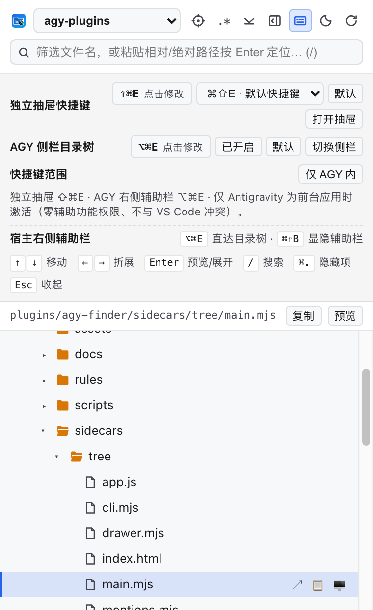

# AGY Finder 项目目录树 (`agy-finder`)

[](https://github.com/Dong-Kevin/agy-plugins/releases)
[](#安装与启用)
[](#安装与启用)
[](#核心特性)
[](./LICENSE)

**简体中文** | **[English](./README_EN.md)** · [界面预览](#界面预览) · [快捷键与 CLI](#快捷键与-cli) · [核心特性](#核心特性) · [安装与启用](#安装与启用) · [本地开发与校验](#本地开发与校验)

轻量、零外部依赖、跨平台（macOS / Windows / Linux）的 **Google Antigravity** 右侧辅助栏（Aux Pane）与独立抽屉项目目录树插件，现统一维护于 **[Dong-Kevin/agy-plugins](https://github.com/Dong-Kevin/agy-plugins)**。

针对 Antigravity 桌面端右侧缺乏完整项目目录树、点击对话路径无法展开定位目录位置的问题，提供 **「对话内直点深链接 + 日志增量提取双保险」** 方案。

---

## 界面预览

<table>
  <tr>
    <td width="33%" align="center" valign="top">
      
      <br/>
      <b>对话提及 + 展开高亮定位</b><br/>
      <sub>顶部聚合对话提及文件芯片，点击即展开对应目录并脉冲高亮目标文件，支持复制路径 / 原生预览</sub>
    </td>
    <td width="33%" align="center" valign="top">
      
      <br/>
      <b>双快捷键自定义（<code>⌘⇧E</code> / <code>⌥⌘E</code>）与键位速查</b><br/>
      <sub>支持点击录制独立抽屉与 AGY 右侧辅助栏双快捷键，仅 AGY 前台 / 全局切换与完整键盘导航</sub>
    </td>
    <td width="33%" align="center" valign="top">
      
      <br/>
      <b>轻量代码预览弹窗</b><br/>
      <sub>独立抽屉模式下双击或点 <code>↗</code> 秒开代码文本预览，支持 <code>🖥 定位</code> 在系统文件管理器显示</sub>
    </td>
  </tr>
</table>

---

## 快捷键与 CLI

| 触发场景 | 默认快捷键 / 命令 | 说明 |
| :--- | :--- | :--- |
| **独立右侧目录树抽屉（macOS）** | **`⌘⇧E`** | 基于 Carbon `RegisterEventHotKey` 默认仅在 `Antigravity` 前台生效，**零冲突、无需辅助功能权限**；面板右上角 `⌨` 支持**点击录制任意快捷键**、切换 `⌘⌥E` / `⌃⇧E` / `⌘⇧Y` 预设及「仅 AGY 前台 / 全局生效」 |
| **AGY 右侧辅助栏直达（macOS）** | **`⌥⌘E`** | 一键唤醒 Antigravity 原生右侧辅助栏并自动切到 **AGY Finder 目录树**（若未固定可一键激活；支持在 `⌨` 面板点击录制自定义，或用 `agy-finder aux`） |
| **宿主右侧辅助栏原生开关** | **`⌘⇧B`**（macOS）<br/>**`Ctrl+Shift+B`**（Win / Linux） | 开关 Antigravity 原生右侧辅助栏；右键插件标签可 `Pin Tab` 常驻固定 |
| **对话斜杠与深链接直达** | **`/agy-finder`**<br/>点击回复旁 **`[📂]`** · [`sidecar://agy-finder/tree/`](sidecar://agy-finder/tree/) | 聊天中一键打开目录树面板，或直接展开并脉冲高亮指定文件 |
| **终端 CLI 快捷命令** | **`agy-finder`**（独立抽屉）<br/>**`agy-finder aux`**（AGY 侧栏） | 跨平台开关独立抽屉或切换 AGY 右侧辅助栏目录树；Windows / Linux 可分别绑定 `agy-finder toggle` / `agy-finder aux` 为全局热键 |
| **面板内全键盘导航** | `↑` / `↓` · `←` / `→` · `Enter` · `/` · `⌘/Ctrl+.` · `?` · `Esc` | 移动选中、折展目录、预览或展开、搜索过滤、显隐 dotfiles、打开快捷键面板、逐层关闭 |

```bash
agy-finder                          # 等同 agy-finder toggle：打开或关闭右侧独立目录树抽屉
agy-finder open [path]              # 打开独立抽屉并可选定位到指定路径
agy-finder aux [path]               # 唤醒/切换 Antigravity 右侧辅助栏目录树，可选高亮定位路径
agy-finder close                    # 关闭独立抽屉
agy-finder status [--json]          # 查看抽屉、AGY 侧栏与双快捷键状态
agy-finder shortcut [<combo>|off|reset]      # 查看或自定义独立抽屉快捷键
agy-finder aux-shortcut [<combo>|off|reset]  # 查看或自定义 AGY 侧栏目录树快捷键
agy-finder hotkey <preset>          # 快速切换预设：cmd+shift+e | cmd+alt+e | ctrl+shift+e | cmd+shift+y | off
agy-finder quit                     # 退出后台抽屉守护进程
```

---

## 核心特性

- **零依赖、零侵入、跨平台**：纯 `Node.js >= 18` 标准库 + 原生 HTML / CSS / JS + 官方 `sidecar_sdk` 构建，无需 `npm install`，不修改客户端 `app.asar`、不注入 CDP、不修改用户外部 `~/.agents/AGENTS.md` 或 `~/.gemini/config/config.json`。
- **双保险路径定位（支持相对路径、绝对路径、`file://` 与 `:行号`）**：
  1. **聊天直点定位（插件内置 `rules/AGENTS.md`）**：保留 `[文件名](file:///...)` 原生预览链接的同时附带 `[📂](sidecar://agy-finder/tree/?path=...)`，点击即刻在右侧展开目录树并脉冲高亮目标文件。
  2. **100% 确定性兜底（增量字节偏移读取 `transcript_full.jsonl`）**：仅在目录树面板可见时按需轮询（面板收起时 `0%` CPU），通过 `stat` 缓存 + 字节偏移增量解析提取当前会话出现过的真实存在路径，在面板顶部展示 **「对话提及」** 快捷芯片，一键定位目录树（对旧对话或模型漏写链接同样有效）。
  3. **搜索与路径直跳**：搜索框支持实时模糊筛选文件名，也支持粘贴任意相对 / 绝对路径按 `Enter`（或点 `🎯` 读取剪贴板）直接展开树定位；工作区外路径自动挂载所属项目根并展开。
- **高频轻交互**：
  - 单击文件高亮选中并显示路径栏；双击或点 `↗` 调用宿主原生 `fileView` 预览（独立抽屉模式下提供轻量文本预览弹窗）。
  - 行内按钮支持一键复制相对 / 绝对路径（`Shift + 点击` 复制绝对路径）及在系统文件管理器（Finder / Explorer / xdg-open）中定位。

---

## 安装与启用

### 方式 1：让 Antigravity Agent 协助安装（推荐首选）

直接复制下面这段指令发给 **Antigravity Agent**，即可自动完成安装与状态校验：

```text
请帮我安装 AGY Finder 插件（来自 https://github.com/Dong-Kevin/agy-plugins ：macOS / Linux 运行 `bash -c "$(curl -fsSL https://raw.githubusercontent.com/Dong-Kevin/agy-plugins/main/plugins/agy-finder/install.sh)"`，Windows PowerShell 运行 `irm https://raw.githubusercontent.com/Dong-Kevin/agy-plugins/main/plugins/agy-finder/install.ps1 | iex`），安装后验证 `agy-finder status` 并列出快捷键说明。
```

### 方式 2：macOS / Linux 一键安装

```bash
bash -c "$(curl -fsSL https://raw.githubusercontent.com/Dong-Kevin/agy-plugins/main/plugins/agy-finder/install.sh)"
```

卸载：

```bash
bash -c "$(curl -fsSL https://raw.githubusercontent.com/Dong-Kevin/agy-plugins/main/plugins/agy-finder/install.sh)" -- --uninstall
```

### 方式 3：Windows PowerShell 一键安装

```powershell
irm https://raw.githubusercontent.com/Dong-Kevin/agy-plugins/main/plugins/agy-finder/install.ps1 | iex
```

卸载：

```powershell
.\plugins\agy-finder\install.ps1 -Uninstall
```

### 方式 4：通过总仓克隆安装

```bash
git clone https://github.com/Dong-Kevin/agy-plugins.git
cd agy-plugins
./install.sh agy-finder        # Windows PowerShell 执行：.\install.ps1 -Plugin agy-finder
```

### 方式 5：通过官方 `agy` CLI 安装本地目录

```bash
agy plugin install ./plugins/agy-finder
```

安装完成后，Antigravity 会自动加载并启用 **AGY Finder 项目目录树**（可在左侧 **Customizations → Installed** 中随时开关管理），按 `⌘⇧E`（独立抽屉）、`⌥⌘E`（AGY 右侧辅助栏直达），或点击对话中的 `[AGY Finder 目录树](sidecar://agy-finder/tree/)` 即可打开。

---

## 本地开发与校验

```bash
# 运行完整自检（清单规范、语法、CSS 隔离、路径解析、增量日志解析、HTTP 环回与安装测试）
node scripts/verify.mjs

# 独立 Web 预览模式（仅监听 127.0.0.1）
node sidecars/tree/main.mjs --standalone --port 18980
```

## License

MIT License
