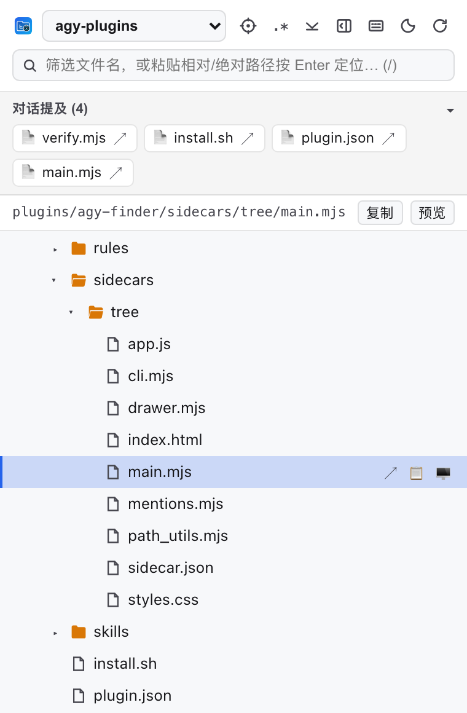
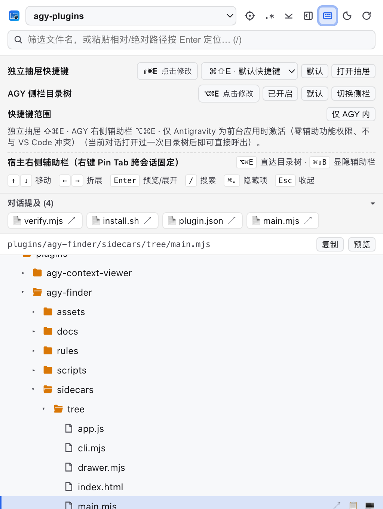
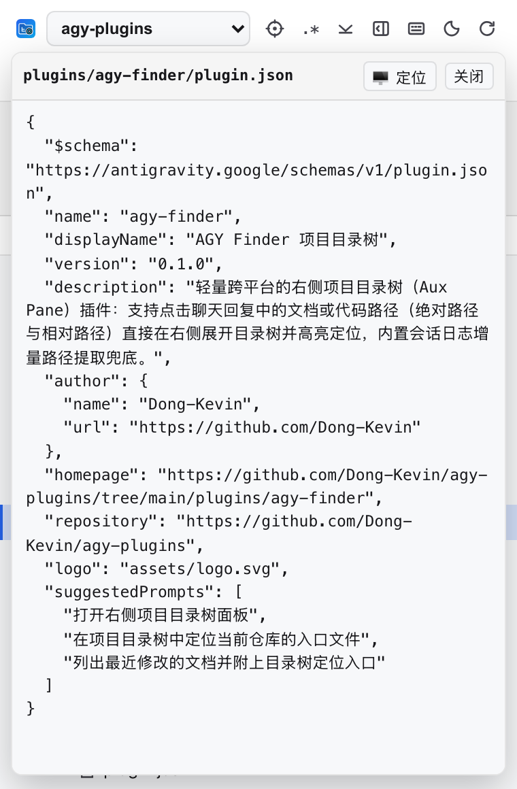

# AGY Finder (`agy-finder`)

A lightweight project file tree for **Google Antigravity** -- click **`[📂]`** deep links in chat replies or press a hotkey to instantly reveal and highlight the target file, inspect conversation mentions, search files cleanly, and preview code in place or in a macOS slide-over drawer.

[简体中文](README.md) | **English** | [Monorepo Home](../../README_EN.md)

---

## One-Sentence Agent Install

Send this prompt to Antigravity to install and verify automatically:

```text
Please install the AGY Finder plugin from https://github.com/Dong-Kevin/agy-plugins (on macOS/Linux run `bash -c "$(curl -fsSL https://raw.githubusercontent.com/Dong-Kevin/agy-plugins/main/plugins/agy-finder/install.sh)"`, on Windows PowerShell run `irm https://raw.githubusercontent.com/Dong-Kevin/agy-plugins/main/plugins/agy-finder/install.ps1 | iex`), verify `agy-finder status`, and summarize its keyboard shortcuts.
```

<details>
<summary>Manual CLI Install / Hot Upgrade / Uninstall (macOS · Linux · Windows)</summary>

```bash
# macOS / Linux -- install or hot-upgrade
bash -c "$(curl -fsSL https://raw.githubusercontent.com/Dong-Kevin/agy-plugins/main/plugins/agy-finder/install.sh)"

# Uninstall
bash -c "$(curl -fsSL https://raw.githubusercontent.com/Dong-Kevin/agy-plugins/main/plugins/agy-finder/install.sh)" -- --uninstall
```

```powershell
# Windows PowerShell -- install or hot-upgrade (uninstall via .\plugins\agy-finder\install.ps1 -Uninstall)
irm https://raw.githubusercontent.com/Dong-Kevin/agy-plugins/main/plugins/agy-finder/install.ps1 | iex
```

- You can also extract `agy-finder-v0.2.7.zip` from [Releases](https://github.com/Dong-Kevin/agy-plugins/releases) and run `./install.sh`, or run `agy plugin install ./plugins/agy-finder`.

</details>

---

## Shortcuts & Where to Customize

| Trigger | Default Key / Action | What It Does | Where to Customize |
| :--- | :--- | :--- | :--- |
| **macOS Slide Drawer** | **`⌘⇧E`** | Toggles the standalone right-edge file drawer, auto-hiding on blur with zero Accessibility permissions | **Top-right `⌨` button (or press `?`)** -> **`⇧⌘E` record button** / presets / **`AGY Only / Global`**<br/>CLI: `agy-finder shortcut [combo\|reset\|off]` · `agy-finder hotkey <preset>` |
| **AGY Aux Pane Jump** | **`⌥⌘E`** (bind CLI on Win/Linux) | Wakes Antigravity's Right Aux Pane straight to AGY Finder from `Overview`, collapsed, or other tabs | **Top-right `⌨` button** -> **`⌥⌘E` record button**; **right-click tab -> `Pin Tab`** to stay pinned<br/>CLI: `agy-finder aux-shortcut [combo\|reset\|off]` |
| **Host Panel & Deep Links** | **`⌘⇧B`** (`Ctrl+Shift+B` Win/Linux)<br/>**`/agy-finder`** · **`[📂]`** | Toggles host Aux Pane; clicking `[📂]` in chat expands & pulse-highlights that exact file | Ships with local `rules/AGENTS.md` linking convention (zero client core modifications) |
| **Tree Navigation** | **`↑/↓`** · **`←/→`** · **`Enter`** · **`/`** · **`⌘.`** | Move, expand/collapse, inline preview modal, fuzzy file search, toggle dotfiles | Toolbar **`🌙`** switches Light/Dark theme; drawer icon opens standalone mode |

<details>
<summary>Quick <code>agy-finder</code> Terminal Commands</summary>

```bash
agy-finder                      # Toggle the standalone right-edge drawer
agy-finder open [path]          # Open the drawer and reveal a target path
agy-finder aux [path]           # Jump Antigravity's Right Aux Pane straight to File Tree (Win/Linux OS hotkey friendly)
agy-finder status [--json]      # Inspect drawer, Aux Pane & dual shortcut settings
agy-finder shortcut <combo>     # Customize drawer shortcut ('reset' | 'off' | '--global')
agy-finder aux-shortcut <combo> # Customize AGY Aux Pane jump shortcut
agy-finder quit                 # Stop the background drawer daemon
```

</details>

---

## Visual Preview

<table>
  <tr>
    <td align="center" width="33%">
      <strong>Mentions &amp; Tree Reveal</strong><br/>
      
    </td>
    <td align="center" width="33%">
      <strong>Shortcut Panel (Click <code>⌨</code>)</strong><br/>
      
    </td>
    <td align="center" width="33%">
      <strong>Inline Quick Preview</strong><br/>
      
    </td>
  </tr>
</table>

---

## Notes & License

- **Coexisting Plugin Lock**: When installed alongside `context-viewer`, both share `~/.gemini/antigravity/agy_aux_pane_trigger.json`. Keep `context-viewer >= v1.7.4` and restart existing daemons cleanly.
- **Verification**: Requires `Node.js >= 18`. Verified on Apple Silicon macOS with live host interaction; Windows & Linux support the native AGY Aux Pane Sidecar and `agy-finder` CLI. Local test suite: `node plugins/agy-finder/scripts/verify.mjs` ([MIT License](./LICENSE)).
